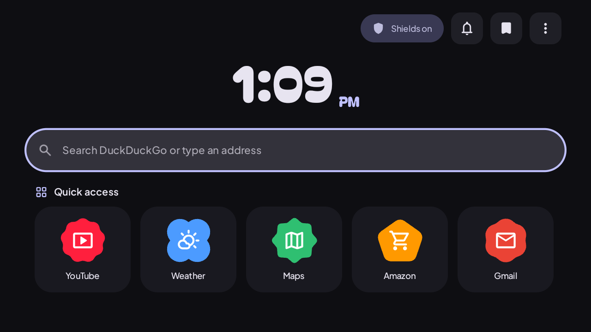
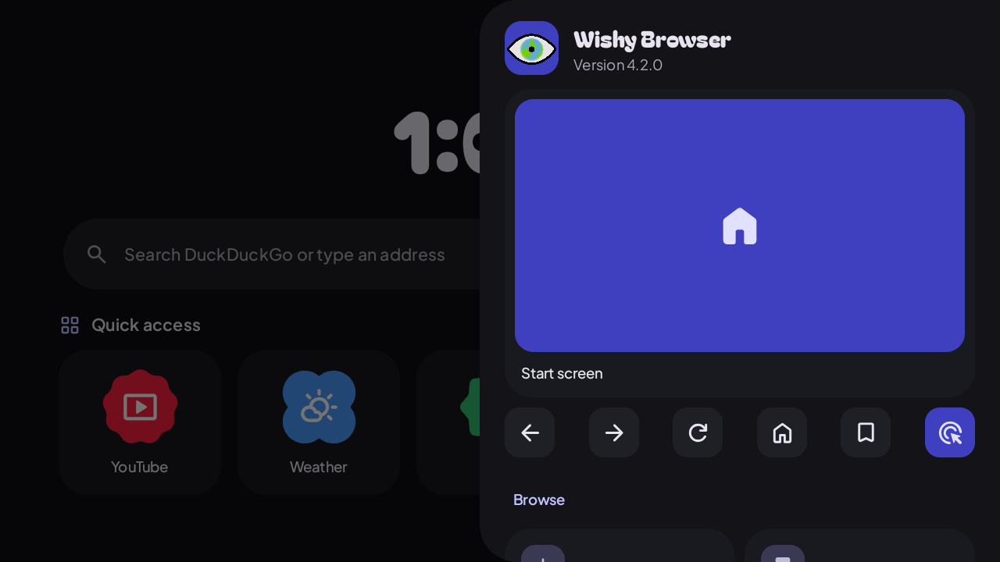
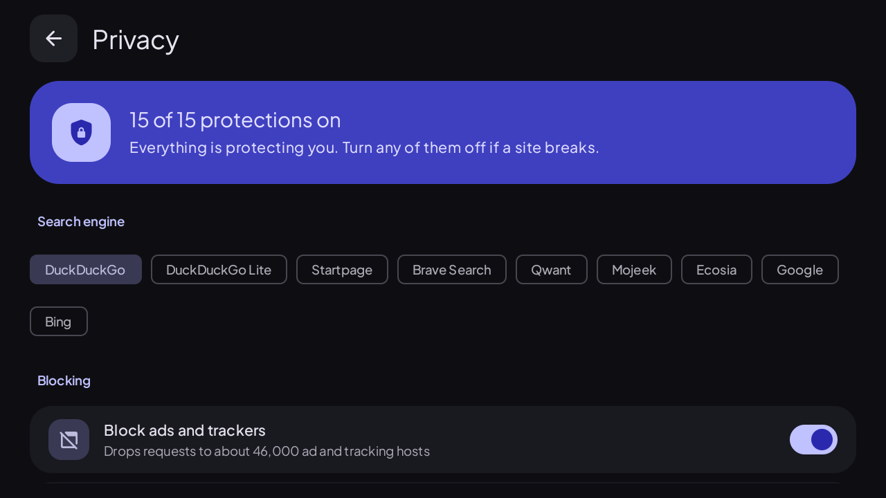
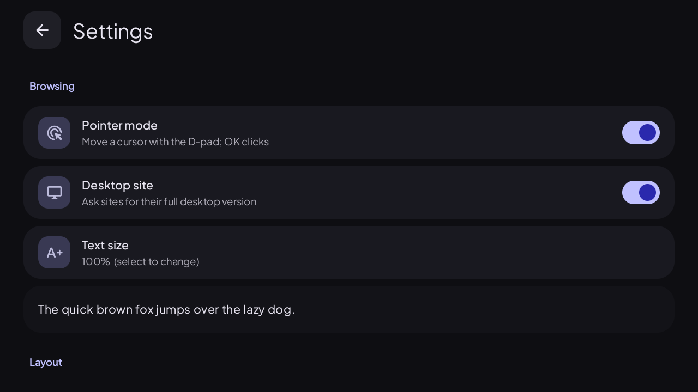
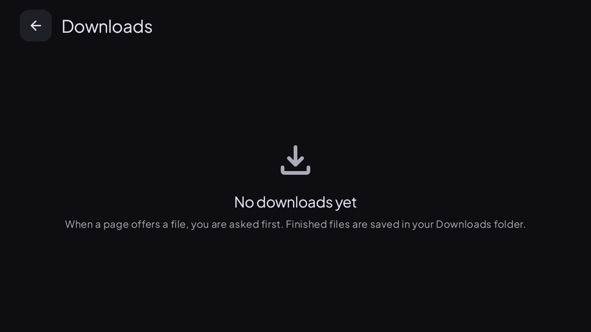

<div align="center">


# Wishy Browser

**A lightweight, privacy-focused browser made for Android TV.**

Browse the web on your TV with remote-friendly controls, full-screen mode, flexible layouts, built-in download manager, and zero-telemetry privacy protections.

<p>
  <a href="https://github.com/wishissue/WishyBrowser/releases">Download v4.2.0</a> ·
  <a href="https://github.com/wishissue/WishyBrowser/issues">Report a bug</a> ·
  <a href="https://github.com/wishissue/WishyBrowser">Source code</a> ·
  <a href="https://wishissue.github.io/wishy-apps/donate.html">Donate</a>
</p>

<div align="center">

<a href="https://wishissue.github.io/wishy-apps/donate.html">
  
</a>

</div>


</div>

---

## Screenshots

<div align="center">

<table>
  <tr>
    <td align="center" width="50%">
      <b>Home Screen & Clock</b><br>
      
    </td>
    <td align="center" width="50%">
      <b>Quick Menu & Actions</b><br>
      
    </td>
  </tr>
  <tr>
    <td align="center" width="50%">
      <b>Privacy Protections & Search</b><br>
      
    </td>
    <td align="center" width="50%">
      <b>Settings & Layout Options</b><br>
      
    </td>
  </tr>
  <tr>
    <td align="center" width="100%" colspan="2">
      <b>Download Manager</b><br>
      
    </td>
  </tr>
</table>

</div>

---

## What's New in v4.2.0

- **Built-in OkHttp Download Manager**: Foreground service download engine supporting pause, resume, retry, cancel, progress notifications, and "Ask before downloading" privacy prompt.
- **Full-Screen Mode**: Hide toolbars and system bars completely. Easily reveal the floating toolbar by dragging in from the edge, pushing the D-pad pointer, or pressing `SEARCH` / holding `MENU`.
- **Flexible Toolbar Positions**: Position the toolbar on the **Top, Bottom, Left, or Right** of your screen (*Settings > Layout*).
- **15 Built-in Privacy Protections**: Block ads/trackers, hide cookie pop-ups, block third-party cookies, clean tracking links, strip referrers, send GPC/DNT, fingerprint noise, and force HTTPS upgrades.
- **Wishy Blue Palette & Design**: Redesigned M3 Expressive theme with Plus Jakarta Sans interface typography and Bagel Fat One title branding.

---

## Why Wishy Browser?

TV browsers can be awkward to control with a D-pad remote or bloated with phone-centric clutter. Wishy Browser is engineered specifically for Android TV:

- **Made for TV** — Effortless remote control navigation and smart D-pad pointer snapping.
- **Zero Telemetry & Private** — No user tracking, no accounts, and "Clear browsing data now" session cleanup.
- **Custom Download Manager** — Download files directly to your TV's Downloads directory with OkHttp.
- **Open Source** — Transparent codebase, open issues, and active community development.

---

## Features

- **Remote-Friendly Navigation**: D-pad focus handling with cursor snapping to clickable page links.
- **Pointer Mode**: Smooth pointer for websites that require mouse/touch interaction.
- **Download Hub**: Manage file downloads with pause, resume, and progress notifications.
- **Full-Screen Video**: Expand web video players to full screen with remote control support.
- **Search Engine Selection**: Choose between DuckDuckGo, Startpage, Brave, Qwant, Mojeek, Ecosia, Google, and Bing.
- **Reader View**: Convert articles into clean, distraction-free text.
- **Customizable Themes**: Palette customization including dusk, dark, light, and OLED black modes.

> Website compatibility depends on the device's Android System WebView version. Streaming services requiring specific DRM may vary by hardware.

---

## Install

1. Visit [Wishy Browser Releases](https://github.com/wishissue/WishyBrowser/releases).
2. Download the latest `v4.2.0` APK (one file for every device).
3. Transfer the APK to your Android TV device and install it.

---

## Build from Source

### Requirements

- Android Studio and Android SDK
- JDK 17 or newer

### Release signing

Updates only install over an existing copy when both APKs are signed with the same key. Create a key once and keep it safe:

```bash
keytool -genkeypair -v -keystore wishy.jks -alias wishy -keyalg RSA -keysize 4096 -validity 10000
```

Locally, set `WISHY_KEYSTORE`, `WISHY_KEYSTORE_PASSWORD`, `WISHY_KEY_ALIAS` and `WISHY_KEY_PASSWORD` (environment or `~/.gradle/gradle.properties`). On GitHub, add the repository secrets `WISHY_KEYSTORE_BASE64` (`base64 -w0 wishy.jks`), `WISHY_KEYSTORE_PASSWORD`, `WISHY_KEY_ALIAS` and `WISHY_KEY_PASSWORD`. Without them the debug key is used. Never commit the `.jks` file.

### Build Release APK

```bash
git clone https://github.com/wishissue/WishyBrowser.git
cd WishyBrowser
./gradlew assembleRelease
```

---

## License

See the [`LICENSE`](LICENSE) file in this repository for licensing details.

---

<div align="center">

**Wishy Browser — the web, on your TV.**

[GitHub repository](https://github.com/wishissue/WishyBrowser) · [Releases](https://github.com/wishissue/WishyBrowser/releases) · [Issues](https://github.com/wishissue/WishyBrowser/issues)

</div>
