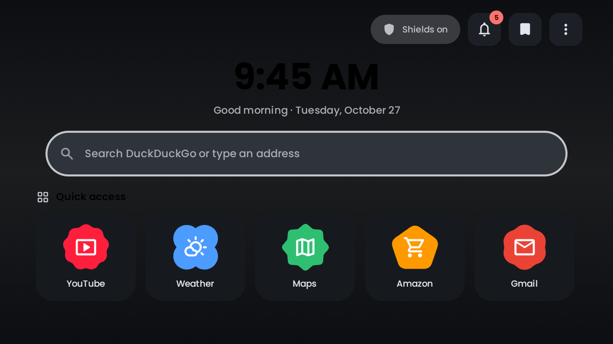
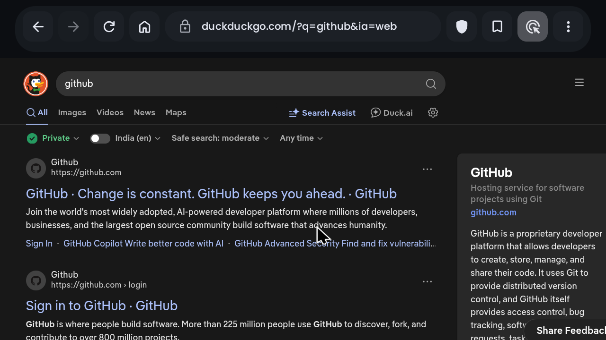
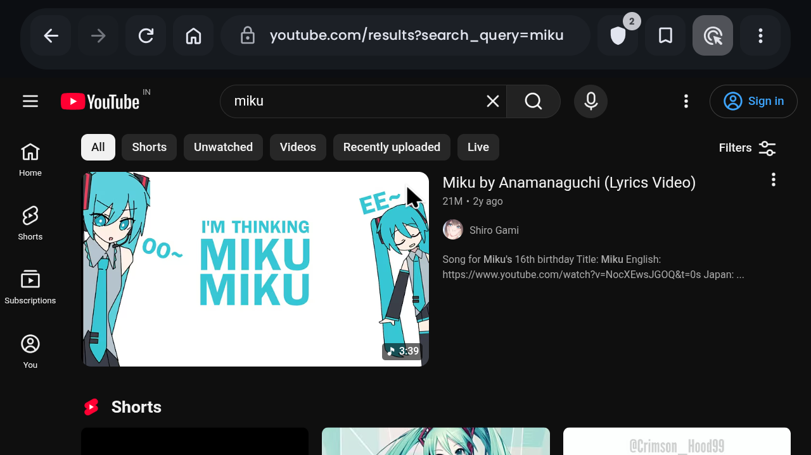
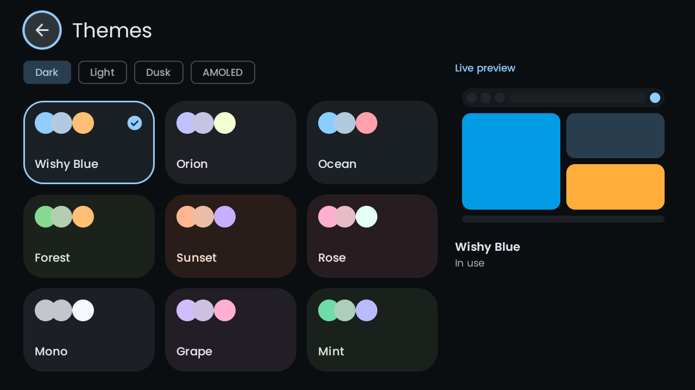
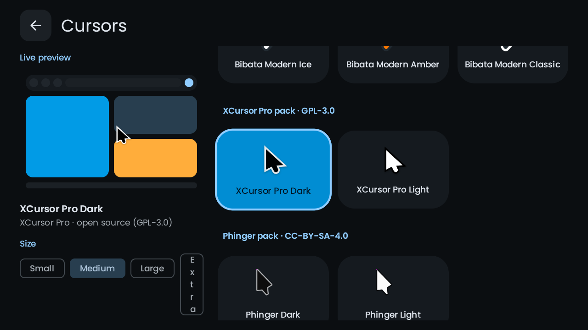
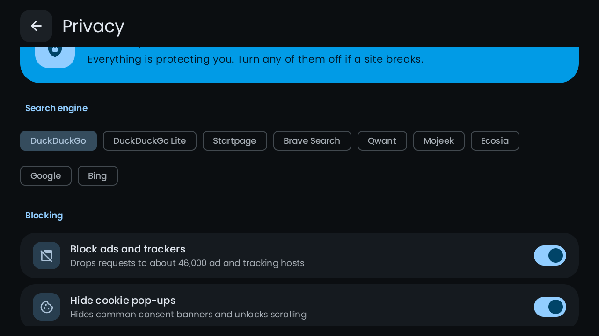
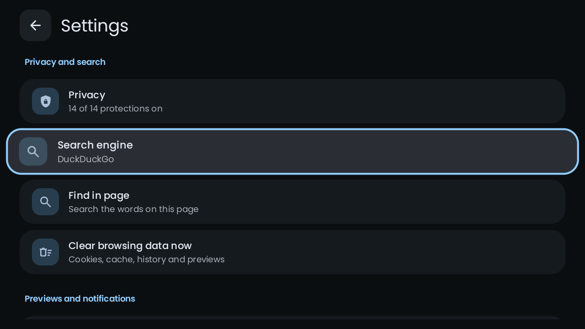

<div align="center">


# Wishy Browser

**A lightweight, privacy-focused browser made for Android TV.**

Browse the web on your TV with remote-friendly controls, a clean interface, and privacy features designed to keep your browsing session from sticking around.

<p>
  <a href="https://github.com/wishissue/WishyBrowser/releases">Download</a> ·
  <a href="https://github.com/wishissue/WishyBrowser/issues">Report a bug</a> ·
  <a href="https://github.com/wishissue/WishyBrowser">Source code</a>
</p>


</div>

---

## Screenshots

<div align="center">

<table>
  <tr>
    <td align="center" width="50%">
      
    </td>
    <td align="center" width="50%">
      
    </td>
  </tr>
  <tr>
    <td align="center" width="50%">
      
    </td>
    <td align="center" width="50%">
      
    </td>
  </tr>
  <tr>
    <td align="center" width="50%">
      
    </td>
    <td align="center" width="50%">
      
    </td>
  </tr>
  <tr>
    <td align="center" width="50%">
      
    </td>
    <td align="center" width="50%">
      
    </td>
  </tr>
</table>

</div>

## Why Wishy Browser?

TV browsers can be awkward to use with a remote, overloaded with features you don't need, or unclear about what they store. Wishy Browser aims to make browsing on the big screen simpler.

- **Made for TV** — navigate with your remote and use pointer mode on websites that need it.
- **Privacy-minded** — designed to clear browsing-session data instead of keeping a long-term local trail.
- **No account required** — open the browser and get started.
- **Open source** — inspect the code, report issues, and contribute improvements.

## Features

- Remote-friendly navigation and focus handling
- Pointer mode for websites that are difficult to control with a D-pad
- Local bookmarks
- Fullscreen video playback where supported by the website
- Reader View for supported pages
- Customizable themes and appearance
- Address bar for URLs and search queries
- Ad and tracker blocking with limitations inherent to the browser engine
- Session cleanup intended to remove browsing data between launches

> Website compatibility depends on the device, its Android System WebView version, and the website itself. Some streaming services require DRM and may not work.

## Install

1. Visit [Wishy Browser Releases](https://github.com/wishissue/WishyBrowser/releases).
2. Download the latest APK available for your device.
3. Transfer the APK to your Android TV or streaming device and install it. You may need to allow installs from the app you use to open the APK.

If you are unsure which APK to choose, read the release notes before installing.

## Build from source

### Requirements

- Android Studio and a compatible Android SDK
- JDK 17 or newer
- Internet access to download Gradle dependencies

### Build a release APK

```bash
git clone https://github.com/wishissue/WishyBrowser.git
cd WishyBrowser
./gradlew assembleRelease
```

On Windows, run:

```bat
gradlew.bat assembleRelease
```

## Privacy notes

Wishy Browser is designed with local privacy in mind, but it does **not** make you anonymous. Websites can still see your connection details, including your IP address.

- Session cleanup is intended to prevent browsing data from being retained between launches.
- Bookmarks and preferences may be stored locally so the app can remember your choices.
- Blocking is not guaranteed to catch every ad or tracker.
- Some privacy protections can interfere with logins, embedded media, or site functionality.
- Security and compatibility also depend on keeping Android System WebView up to date.

## Known limitations

- Built for TV screens and remote control rather than phone-first use.
- Websites designed for a mouse or touchscreen may need pointer mode.
- Some websites and video players may not work correctly.
- WebView-based blocking is less comprehensive than a full browser extension blocker.
- Performance varies by device, available memory, and WebView version.

If you run into a problem, open an [issue](https://github.com/wishissue/WishyBrowser/issues) and include your device model, Android version, what you did, and what happened.

## Contributing

Contributions, bug reports, and compatibility testing are welcome.

1. Check the [existing issues](https://github.com/wishissue/WishyBrowser/issues).
2. Describe the problem or improvement clearly.
3. Include device details and screenshots or logs when useful.

## License

See the [`LICENSE`](LICENSE) file in this repository for licensing details.

---

<div align="center">

**Wishy Browser — the web, on your TV.**

[GitHub repository](https://github.com/wishissue/WishyBrowser) · [Releases](https://github.com/wishissue/WishyBrowser/releases) · [Issues](https://github.com/wishissue/WishyBrowser/issues)

</div>
